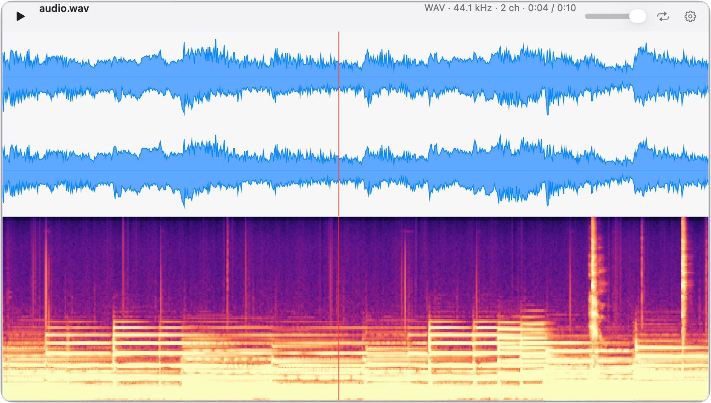

  

# AudioPeek

AudioPeek is a lightweight app designed to supplement the audio preview on Mac.

When previewing audio files on Mac, have you ever wished you could see more than just a scrub bar? AudioPeek allows audio previews to render the waveform *and* spectrogram, filling the gap of a bare bones audio preview and importing files into a professional audio application.

  

## Install

Just like any other Mac application, download the disk image (`AudioPeek.dmg`) from [GitHub Releases](https://github.com/crlandsc/audiopeek/releases). Open it and drag AudioPeek to Applications.

#### IMPORTANT
The first open is *blocked*. macOS shows:
> Apple could not verify "AudioPeek.app" is free of malware that may harm your Mac or compromise your privacy.

This message is expected and requires a one-time action to enable the application:

1. In that dialog, click Done. *Do not* move the app to the Trash.
2. Open **System Settings** > **Privacy & Security**.
3. In the **Security** section, find AudioPeek and click "Open Anyway", then Open.

You only need to do this once. Apple walks through the same steps in [Safely open apps on your Mac](https://support.apple.com/en-us/102445).

#### Allow Finder access
AudioPeek needs to ask Finder which file you have selected. The first time you press the shortcut, macOS asks:
> "AudioPeek" wants access to control "Finder".

Click **Allow**. If you clicked Don't Allow by mistake, AudioPeek opens its Settings with an **Open Automation** button. Click it, turn on **Finder** under AudioPeek, and press the shortcut again.

## How to use it

1. Select an audio file in Finder.
2. Press **Option-Space**.

That's it! AudioPeek opens a small panel over Finder, starts playing, and draws the waveform and spectrogram as it goes. You don't have to wait for the picture to finish before listening.

While the panel is open:

- **Arrow keys** still move around in Finder, and AudioPeek follows along to the next file.
- **Space** plays and pauses.
- **Click or drag** anywhere on the waveform or spectrogram to jump to that spot.
- The **volume slider** and **loop button** are in the top bar. The volume is remembered and never goes louder than the file itself.
- **Esc** or **Option-Space** again closes the panel.

You can also right-click an audio file and choose **Open With** > **AudioPeek**, or drag a file onto the AudioPeek icon.

#### Supported files
AudioPeek plays anything your Mac already knows how to play:

- WAV
- AIFF (`.aif`, `.aiff`)
- MP3
- AAC and Apple Lossless (`.m4a`, `.mp4`)
- FLAC
- Opus (`.opus`)

For video files (`.mp4`), AudioPeek only shows and plays the audio. Long files work too. On an M3 Max, AudioPeek reads about an hour of audio every 6 seconds, and it keeps playing the whole time.

## Settings

Open Settings from the AudioPeek icon in the menu bar, or from the gear in the top right of the panel.

From there you can:

- Change the **shortcut** from Option-Space to something else.
- Show or hide the **waveform** and **spectrogram**, and drag how much room each one gets.
- Show every channel separately instead of one combined view (**dual view**).
- Pick the waveform color and the spectrogram colors.
- Tune the spectrogram (type, resolution, frequency range, and dB range) if you want more control.
- Show or hide the **menu bar icon** and the **Dock icon**.

**Reset** puts every setting back to how it started. It keeps your volume and where you left the panel.

#### Hid both icons?
If you turned off the menu bar icon *and* the Dock icon, open AudioPeek again from Applications (or Spotlight) and Settings comes right back up. The gear in the panel works too.

#### Open at login
AudioPeek turns on **Open at login** the first time it opens a file, so the shortcut is always ready. You can turn it off in Settings. If macOS doesn't allow it, Settings shows an **Open Login Items** button. Click it and add AudioPeek to the list.

## Updating

To update, download the newest `AudioPeek.dmg` from [GitHub Releases](https://github.com/crlandsc/audiopeek/releases), quit AudioPeek, and drag the new copy into Applications to replace the old one. Your settings are kept.

Each new version is treated by macOS as a new app, so you'll need to repeat two quick steps:

1. The **Open Anyway** step from [Install](#install).
2. Turn **Finder** back on for AudioPeek under **System Settings** > **Privacy & Security** > **Automation**.

## Requirements

- macOS 15 (Sequoia) or later
- A Mac with Apple silicon (M1 or newer)

## License

MIT. Copyright (c) 2026 Christopher Landschoot. See [LICENSE](LICENSE).
